# ERP 管理系统

面向中小型离散制造与贸易企业的财务业务一体化 ERP。后端 Java 17 / Spring Boot 3.2，前端 Vue 3 / Element Plus，数据库 MySQL 8。

覆盖采购、销售、库存、生产、总账、应收应付、工作流、人力资源八个域，核心链路做到**业务单据审核即生成会计分录、即时入账**，报表数据来自真实账簿聚合。

---

## 界面预览

> 以下截图均取自本地运行实例，数据来自真实账簿聚合而非演示桩数据。

### 登录

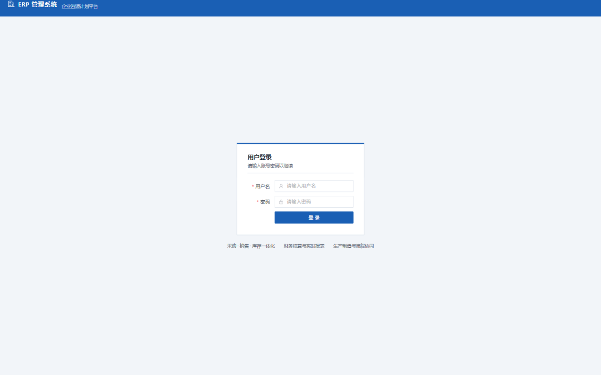

### 工作台

驾驶舱指标全部实时聚合：本期销售额、采购额、库存金额、应收应付余额、在制工单数，以及本年销售趋势、库存金额 TOP、逾期应收 TOP。

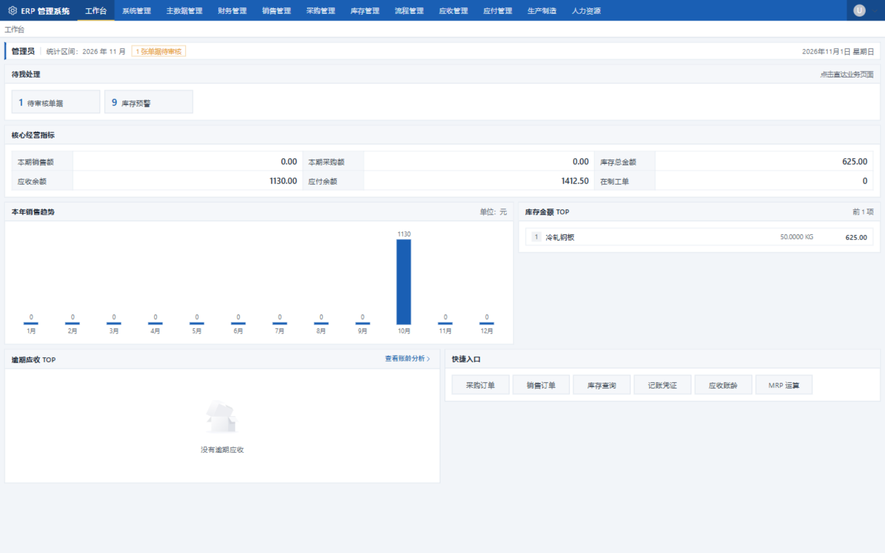

### 采购订单

单据状态机（暂存 → 已审核）在列表上直接可见，审核动作触发审批流与会计分录。

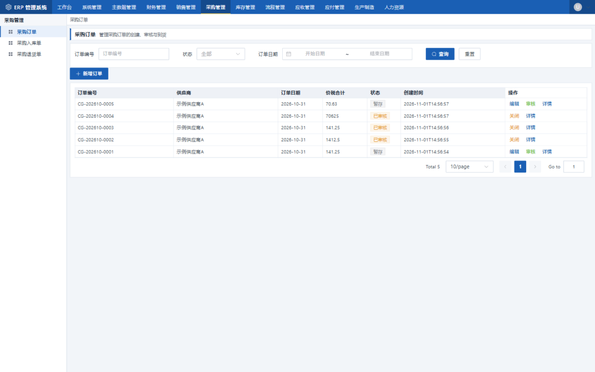

### 记账凭证

凭证与业务单据一一对应，价税分离后的借贷分录在此集中呈现。


### 即时库存

按物料 × 仓库 × 批次维护现存量、锁存量与可用量，移动加权平均成本实时结转。


### 财务报表

资产负债表与利润表同页切换，报表平衡校验即时给出结论。

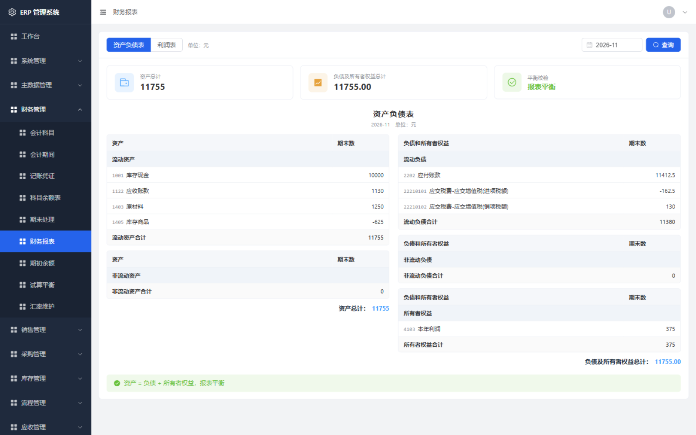

### 试算平衡

按会计期间生成期初、本期发生额与期末余额，校验借贷是否平衡。


### 期初余额

承接存量账套的入口，支持导入与借贷平衡校验。


### 工作流待办

条件分支、多级审批产生的待办任务，支持同意、驳回、转办、加签与退回。

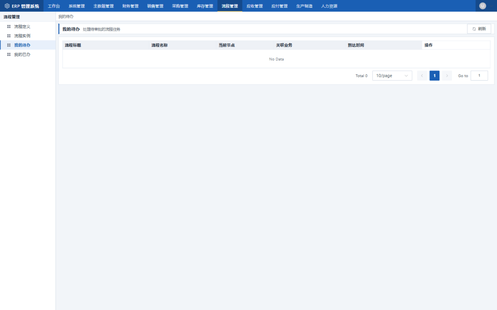

### MRP 运算

按销售需求计算净需求，可直接投放为采购订单或生产订单。

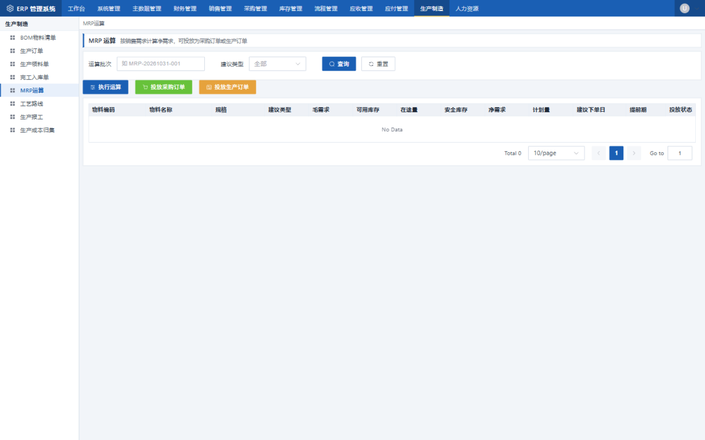

### 应收账龄

按账龄区间统计客户未收金额，识别逾期风险。

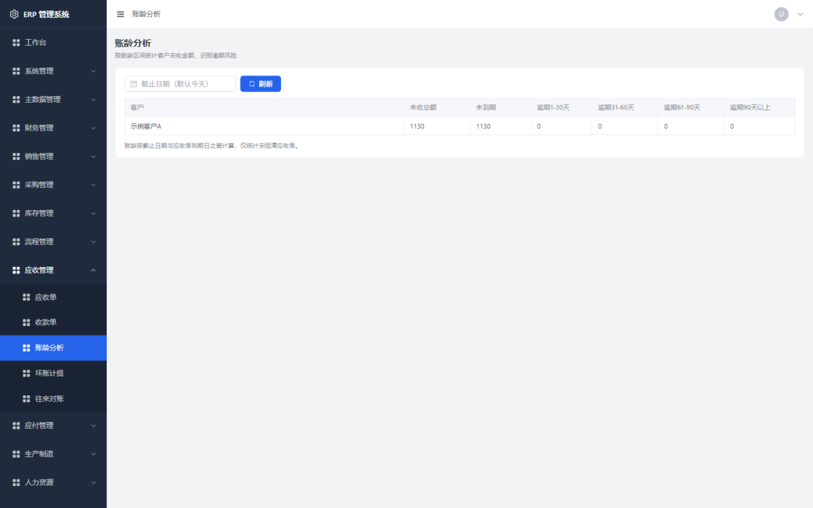

### 生产订单

管理生产订单的下达、领料与完工，工单状态全程可追溯。

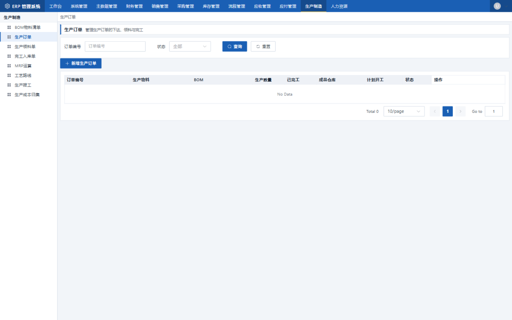

### 销售订单

管理销售订单的创建、审核与发货。

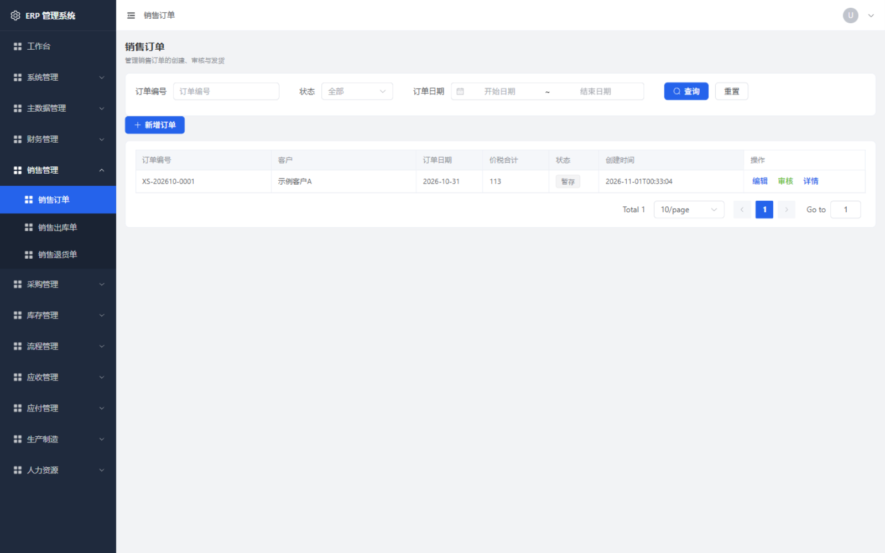

### 角色与数据权限

角色编码、数据范围与菜单权限集中配置，改完即时生效。

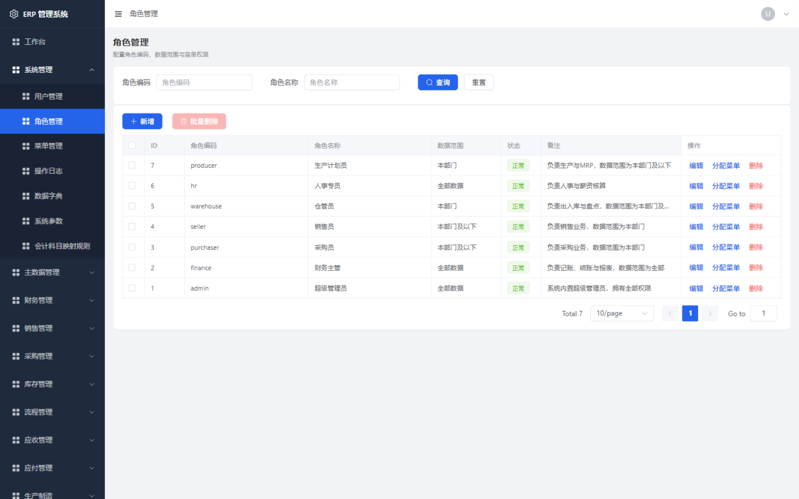

### 采购入库

入库审核即生成价税分离凭证（原材料 / 进项税 / 应付账款）。

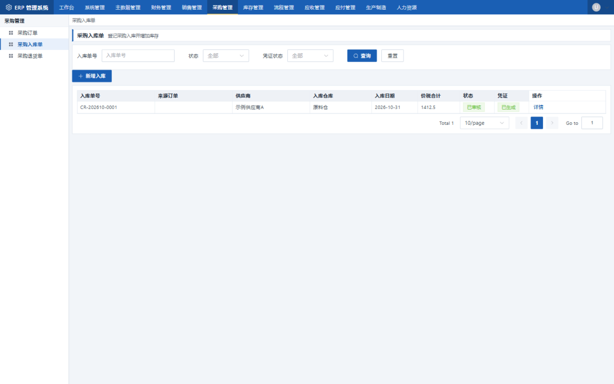

### 数据字典

状态、类型等枚举收敛到字典表，新增选项无需改代码发版。

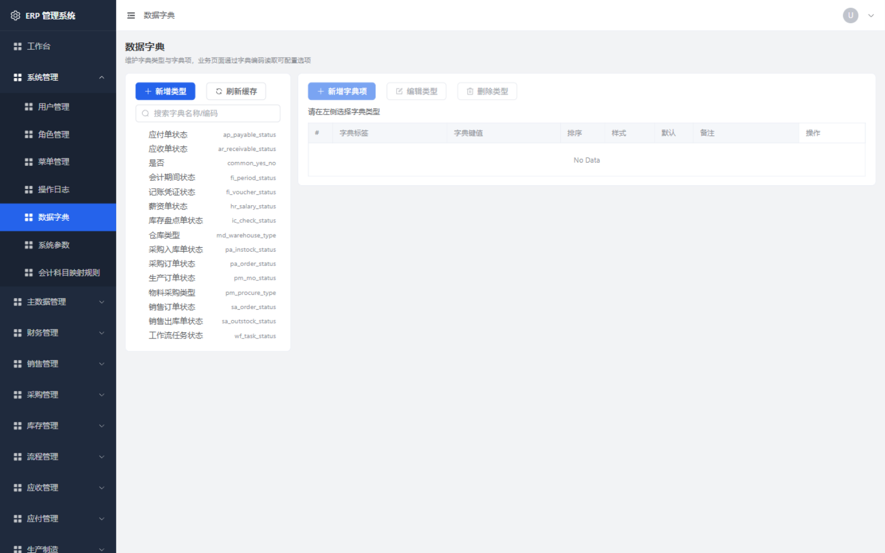

---

## 一、快速启动

### 1. 环境要求

| 组件 | 版本 | 说明 |
|------|------|------|
| JDK | 17+ | 实测 JDK 21 |
| Maven | 3.9+ | |
| Node.js | 20+ | |
| MySQL | 8.0+ | 需开启 `utf8mb4` |
| Redis | 7 | 已依赖但当前未启用，可后接 |

### 2. 启动中间件

```bash
cd erp-server/deploy
docker compose up -d
```

或使用已有的 MySQL 实例，修改 `erp-server/src/main/resources/application.yml` 中的连接信息。

### 3. 初始化数据库

按顺序执行，**每一步都可重复执行（幂等）**：

```bash
cd erp-server

# 1) 基础表结构
mysql -uroot -p erp < src/main/resources/db/schema.sql

# 2) 迁移辅助过程（MySQL 8 不支持 ADD COLUMN IF NOT EXISTS，用存储过程实现幂等加列）
mysql -uroot -p erp < src/main/resources/db/migration/_helpers.sql

# 3) 增量迁移，按版本号顺序
mysql -uroot -p erp < src/main/resources/db/migration/V1_1_0__erp_production_readiness.sql
mysql -uroot -p erp < src/main/resources/db/migration/V1_1_1__wf_enhancement.sql
mysql -uroot -p erp < src/main/resources/db/migration/V1_1_1__pm_enhancement.sql
mysql -uroot -p erp < src/main/resources/db/migration/V1_1_2__sys_dict.sql
mysql -uroot -p erp < src/main/resources/db/migration/V1_1_3__sys_serial_no.sql

# 4) 初始化数据（菜单权限、角色、主数据、会计科目、科目映射规则、字典）
mysql -uroot -p erp < src/main/resources/db/data.sql
```

### 4. 启动后端

```bash
cd erp-server
mvn spring-boot:run
```

服务默认监听 `8487`，接口文档 `http://localhost:8487/doc.html`。

### 5. 启动前端

```bash
cd erp-web
npm install
npm run dev
```

### 5.1 配置初始管理员

管理员口令**不设默认值**，必须由部署方通过环境变量指定：

```bash
export ERP_ADMIN_PASSWORD='你的初始口令'
export JWT_SECRET='至少 32 字节的随机密钥'
```

未配置 `ERP_ADMIN_PASSWORD` 时应用不会创建管理员账号，需要在系统管理中手工建号。
`JWT_SECRET` 未配置或长度不足时应用拒绝签发令牌——固定密钥等同于任何人都能伪造登录态。

### 6. 一键验证

```bash
cd erp-server
bash tools/verify.sh
```

脚本依次完成：停止应用 → 重新打包 → 重置数据库并按序执行所有 SQL → 校验实体与表结构一致性 → 启动应用 → 运行全部五层业务验证（接口巡检、写路径与业务规则、数据权限隔离、业务链路、工作流），共 331 项断言。

单独验证工作流审批链路（条件分支、多级审批、驳回）：

```bash
java -cp "target/classes;target/test-classes;$(cat target/cp.txt)" \
  com.erp.tools.WorkflowE2ETest
```

### 7. 演示账号（可选）

演示账号使用统一口令，因此**不放进初始化流程**，需要时单独导入：

```bash
mysql -uroot -p erp < erp-server/src/main/resources/db/seed/demo_accounts.sql
```

导入后可用下列账号登录，口令统一为 `admin123`：

| 账号 | 角色 | 数据范围 | 说明 |
|------|------|----------|------|
| purchaser | 采购员 | 本部门 | 采购模块 + 审批 |
| seller | 销售员 | 本部门 | 销售模块 + 审批 |
| warehouse | 仓管员 | 本部门及以下 | 库存模块 + 审批 |
| hr | 人事专员 | 全部 | 人力资源模块 |
| producer | 生产计划员 | 本部门及以下 | 生产模块 + 审批 |

---

## 二、核心设计

### 会计科目映射规则驱动凭证生成

业务单据不硬编码科目，通过 `fi_biz_account_rule` 配置映射：

| biz_type | rule_key | 科目 | 方向 |
|----------|----------|------|------|
| PA_INSTOCK | MATERIAL | 1403 原材料 | 借 |
| PA_INSTOCK | TAX | 22210101 进项税额 | 借 |
| PA_INSTOCK | PAYABLE | 2202 应付账款 | 贷 |
| SA_OUTSTOCK | REVENUE | 4001 主营业务收入 | 贷 |
| SA_OUTSTOCK | TAX | 22210102 销项税额 | 贷 |
| SA_OUTSTOCK | RECEIVABLE | 1122 应收账款 | 借 |
| SA_OUTSTOCK | COST | 4002 主营业务成本 | 借 |
| SA_OUTSTOCK | STOCK | 1405 库存商品 | 贷 |

**价税分离**：业务单据上的金额是价税合计，入账时拆成不含税金额与税额分别列示，存货成本与总账口径一致。

### 凭证状态机

```
暂存(0) → 已提交(1) → 已审核(2) → 已记账(3)
                                       ↓
                              已红冲(4) / 已作废(5)
```

- **反审核**：`已审核 → 已提交`，仅审核人可操作，期间必须开放
- **反记账**：`已记账 → 已审核`，凭证退出账簿
- **作废**：保留痕迹但不参与任何账簿计算
- **制单审核分离**：手工凭证的制单人不能审核自己提交的凭证；业务单据自动生成的凭证不受此限（其内控由业务单据自身的审批流保证）

### 期末处理顺序

```
1. 录入/导入期初余额        → /fi/opening
2. 生成试算平衡表            → /fi/opening/trial-balance
3. 期末调汇（多币别账套）
4. 计提折旧、结转制造费用
5. 损益结转                 → /fi/carry-forward/profit-and-loss
6. 结账                     → /fi/period/{id}/close
```

结账会强制校验：无未记账凭证、试算平衡、损益已结转。任一不通过则拒绝结账。

### 数据权限

角色上的 `data_scope` 决定可见数据范围，拦截器在 SQL 层自动追加过滤条件：

| 取值 | 含义 |
|------|------|
| 1 | 全部数据 |
| 2 | 本部门数据 |
| 3 | 本部门及以下 |
| 4 | 仅本人 |
| 5 | 自定义部门（在 `sys_role_dept` 配置） |

多个角色取最宽松的范围。过滤条件仅在目标表确实存在 `dept_id` / `create_by` 字段时注入，不会产生 unknown column。

### 接口权限

Controller 方法用 `@RequiresPermission("模块:资源:动作")` 声明，权限码实时查库，改角色后立即生效。超级管理员（角色 ID=1）绕过校验。

```java
@PostMapping("/{id}/audit")
@RequiresPermission("fi:voucher:audit")
@OperLog(module = "fi", type = "AUDIT", value = "审核记账凭证")
```

### 操作日志

`@OperLog` 标注的方法会记录请求参数、结果、耗时与异常信息到 `sys_oper_log`，供审计追溯。

### 数据字典

状态、类型等枚举值收敛到 `sys_dict_data`，管理端可配置。前端通过 `DictSelect` / `DictTag` 组件使用：

```vue
<DictSelect v-model="query.status" dict-type="pa_order_status" placeholder="全部" clearable />
<DictTag dict-type="fi_voucher_status" :value="row.status" />
```

### 工作流审批

业务单据的审核可以接入审批流。配置流程定义（`wf_definition` + `wf_node`）后：

```
业务单据「审核」→ approvalGate.tryStart(...) → 发起审批流 → 审批通过 → 回调真正执行审核
```

**关键设计**：审核逻辑只有一份。业务审核方法开头调用 `approvalGate.tryStart()`，若该业务类型配置了审批流则直接返回，审批通过后由 `ApprovalDispatcher` 回调再次调用同一方法——此时 `ApprovalDispatcher.inCallback()` 为真，不会重复发起流程。

条件分支用表达式求值，语法示例：

```
amount > 50000          金额超过 5 万
type == '采购' && dept == 96013
```

| 能力 | 支持情况 |
|------|----------|
| 节点类型 | 发起 / 审批 / 条件分支 / 结束 / 抄送 / 并行分支 |
| 会签模式 | 任一通过（`multi_approve=1`）、全部通过（`=2`） |
| 审批人解析 | 指定角色 / 指定用户 / 发起人 / 发起人主管 / 部门负责人 / 连续多级主管 |
| 异常处理 | 解析不到审批人时挂起流程并记录原因，等待人工介入，不静默失败 |
| 操作 | 同意 / 驳回 / 退回上一节点 / 转办 / 加签 / 撤回 |
| 超时提醒 | 节点可配置 `timeout_hours`，定时任务扫描并提醒 |

已接入审批流的业务：采购订单、销售订单、采购入库、销售出库、库存盘点、库存调拨、生产订单、生产领料。

---

## 三、验证工具

`erp-server/src/test/java/com/erp/tools/` 下提供四个开发期工具，都可直接运行：

### E2ETest — 端到端业务流程验证

启动应用后运行，覆盖 26 个业务场景：

```bash
cd erp-server
mvn test-compile -DskipTests
mvn dependency:build-classpath -Dmdep.outputFile=target/cp.txt -DincludeScope=runtime

java -cp "target/classes;target/test-classes;$(cat target/cp.txt)" \
  com.erp.tools.E2ETest
```

覆盖：登录、刷新令牌、期初余额、采购下单→入库→凭证→记账、价税分离校验、试算平衡、销售出库→收入确认、应收生成、库存不足拦截、资产负债表平衡、损益结转、结账、期间锁定、驾驶舱、MRP。

### SchemaEntityValidator — 实体与表结构一致性校验

扫���所有 `@TableName` 实体，与数据库实际列比对，找出「实体有字段但表无列」的疏漏：

```bash
java -cp "target/classes;target/test-classes;$(cat target/cp.txt)" \
  com.erp.tools.SchemaEntityValidator \
  "jdbc:mysql://localhost:3306/erp?useSSL=false&serverTimezone=Asia/Shanghai" root your_password \
  "D:/GitHub/ERP/erp-server/src/main/java"
```

### SqlRunner — SQL 脚本执行器

```bash
# 执行 SQL 文件
java -cp ... com.erp.tools.SqlRunner <url> <user> <pass> <sqlFile>

# 重置数据库（验证全量初始化脚本）
java -cp ... com.erp.tools.SqlRunner <url> <user> <pass> --drop
```

### DbInspect — 数据库查询

```bash
java -cp ... com.erp.tools.DbInspect <url> <user> <pass> "SELECT ..." "SELECT ..."
```

---

## 四、测试

```bash
cd erp-server
mvn test          # 74 个单元测试
```

覆盖表达式引擎、价税分离、薪资个税计算、工作流引擎与审批人解析。

---

## 五、目录结构

```
erp-server/
  src/main/java/com/erp/
    common/       公共能力：结果包装、异常处理、表达式引擎、价税分离工具
    config/       MyBatis-Plus 配置（分页、数据权限拦截器）
    security/     认证授权：JWT、权限切面、数据权限解析、操作日志
    system/       系统管理：用户、角色、菜单、字典、参数、操作日志
    md/           主数据：物料、客户、供应商、仓库、单位、价格表、批次、序列号
    wf/           工作流：流程定义、引擎、审批人解析、业务集成
    fi/           财务：科目、期间、凭证、结转、期初余额、报表
    pa/ sa/ ic/   采购 / 销售 / 库存
    pm/           生产：BOM、工艺路线、MRP、生产订单、领料、完工、报工、成本
    ar/ ap/ hr/   应收 / 应付 / 人力资源
    bi/           驾驶舱统计
  src/main/resources/db/
    schema.sql           基础表结构（幂等）
    data.sql             初始化数据（幂等）
    migration/           增量迁移（幂等）
  src/test/java/com/erp/tools/   开发与验证工具

erp-web/src/
  api/           API 封装
  components/    DictSelect / DictTag 字典组件
  utils/         请求封装、字典辅助
  views/         业务页面
```

---

## 六、已知限制

以下能力尚未实现或仅完成基础版本，上生产前需要评估：

- **多币别**：汇率表与调汇框架已就位，但外币凭证的自动折算与期末调汇未接入业务流程
- **固定资产**：无卡片、无折旧计提
- **往来对账**：应收应付与总账的自动对账未实现
- **薪资自动化**：个税与社保可按政策计算，但考勤数据需外部导入
- **报表引擎**：三大报表为硬编码科目归集，非可视化设计器
- **移动端**：仅有 PC 端，未提供 uni-app 移动端

---

*本文档描述的是代码实际状态，与 `docs/项目规划书.md` 的规划目标存在差异，以本文档为准。*


