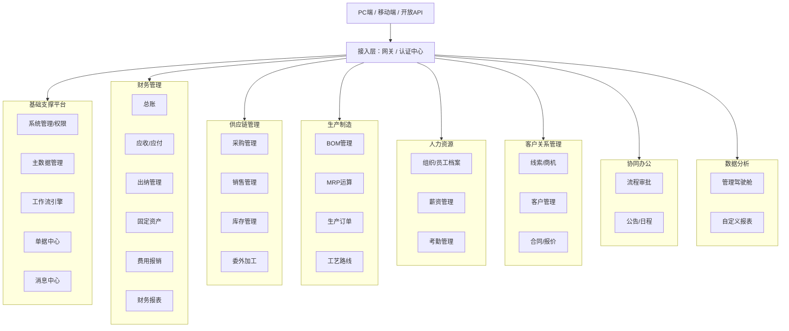
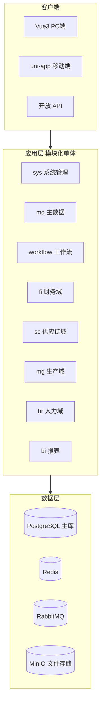
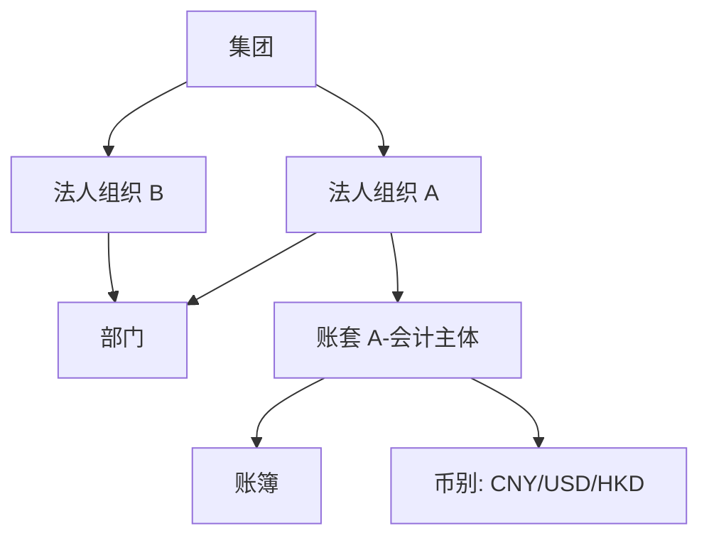
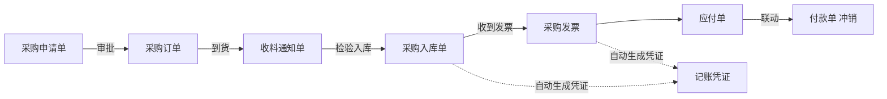
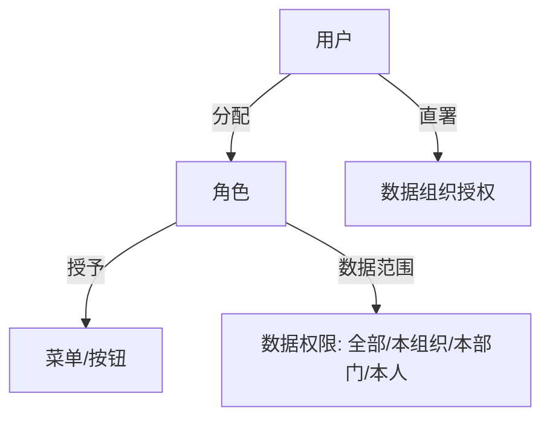
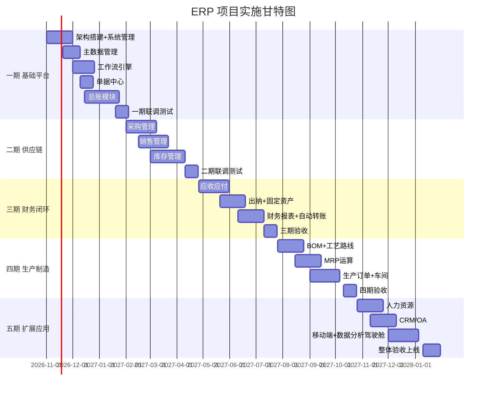

# ERP 管理系统项目规划书

> 版本：v1.0　　编制日期：2026-10-12　　密级：内部

---

## 一、项目概述

### 1.1 项目背景

企业经营日益复杂，业务、财务、供应链、生产之间的数据割裂问题突出。本项目旨在研发一套**自主可控、财务业务一体化、可配置、可扩展**的 ERP 管理系统，覆盖财务、供应链、生产制造、人力资源四大板块的通用能力，支持中小企业到中大型组织的数字化管理需求。

### 1.2 项目目标

| 目标 | 说明 |
|------|------|
| 财务业务一体化 | 采购、销售、库存等业务单据自动生成会计凭证，账实相符 |
| 多组织管理 | 支持多法人、多部门、多账套、多币别核算 |
| 平台化 | 主数据、单据、流程、报表均可配置化扩展，而非硬编码 |
| 权限精细 | 功能权限 + 数据权限双重管控 |
| 技术先进 | 模块化单体演进微服务，支持容器化部署 |

### 1.3 主流 ERP 产品形态分析

市面主流 ERP 按组织规模与交付形态分为四类，本项目取其共性能力作为功能设计依据：

| 产品形态 | 典型定位 | 通用能力特征 |
|----------|----------|--------------|
| 单体套件型 | 中小型企业 | 财务+供应链+生产完整闭环 |
| 平台云化型 | 中大型组织 | 多组织云化、低代码平台、开放 API 生态 |
| 轻量 SaaS 型 | 小微企业 | 轻量化、按需启用模块 |
| 集团管控型 | 集团总部 | 集团合并报表、人力资本管理 |

**本系统重点借鉴：**
1. 财务业务一体化设计与自动转账机制
2. 主数据（物料、客户、供应商、科目）统一管控
3. 单据驱动的业务流程（一单到底、上下游单据联查）
4. 多组织、多账套、多币别、多计量单位核算体系
5. 可配置工作流引擎（BPM）
6. Excel 风格的报表与查询工具（导出即用，贴近财务人员习惯）

### 1.4 设计原则

- **单据驱动**：一切业务以单据为载体，单据状态机驱动流程。
- **配置优于开发**：参数、流程、报表、字段扩展通过配置完成。
- **高内聚低耦合**：按领域划分模块，模块间通过接口/事件通信。
- **审计留痕**：所有关键数据保留创建人、时间、版本、变更日志。
- **先单体后分布式**：避免过早微服务化，演进式架构。

---

## 二、系统总体功能架构

### 2.1 模块清单与优先级

| 模块 | 功能点 | 优先级 | 说明 |
|------|--------|--------|------|
| 系统管理 | 用户/角色/菜单/按钮/日志/字典/参数 | P0 | RBAC + 数据权限 |
| 主数据管理 | 物料、客户、供应商、仓库、职员、会计科目、辅助资料 | P0 | 全局唯一编码规则 |
| 工作流引擎 | 流程定义、节点（审批/会签/条件分支）、流程图设计 | P0 | 表单/流程可配置 |
| 单据中心 | 单据类型、单据转换规则、单据联查、红蓝字冲销 | P0 | 驱动业务流转 |
| 总账 | 凭证录入/审核/记账/结账、多账套、多币别、辅助核算、期末调汇、期间损益结转 | P0 | 财务核心 |
| 采购管理 | 请购→订单→收料→入库→退货→发票 | P0 | |
| 销售管理 | 报价→订单→发货→出库→退货→发票 | P0 | |
| 库存管理 | 出入库、调拨、盘点、批次/序列号、库存预警、可用量计算 | P0 | |
| 应收/应付 | 应收单、收款、核销、账龄分析；应付单、付款、核销 | P1 | 与总账集成 |
| 出纳管理 | 现金/银行账、日记账、银行对账 | P1 | |
| 固定资产 | 资产卡片、折旧、变动、清理、资产报表 | P1 | |
| 财务报表 | 资产负债表、利润表、现金流量表、自定义报表 | P1 | 类 Excel 报表引擎 |
| 费用报销 | 报销单、借款、还款、审批流 | P2 | |
| BOM 管理 | 物料清单、版本、替代料 | P2 | |
| MRP | 需求运算、计划订单、投放 | P2 | |
| 生产订单 | 生产订单、领料、完工入库、返工、生产报表 | P2 | |
| 工艺路线 | 工序、工时、资源 | P3 | |
| 人力资源 | 员工档案、薪资、考勤 | P3 | |
| CRM | 线索、商机、客户跟进、报价、合同 | P3 | |
| 协同 OA | 公告、日程、流程审批、邮件 | P3 | |
| 数据分析 | 驾驶舱、Dashboard、多维分析 | P3 | |

---

## 三、技术架构

### 3.1 技术选型

| 层次 | 技术 | 选型理由 |
|------|------|----------|
| 后端框架 | **Java 17+ / Spring Boot 3.x** | 企业级 ERP 主流技术栈，生态成熟 |
| 持久层 | **MyBatis-Plus 3.5** | 灵活 SQL，国内主流，适合复杂报表查询 |
| 数据库 | **MySQL 8.0**（实际实现） | 已在 MySQL 8.4 上完成全量初始化与业务链路验证 |
| 缓存 | **Redis 7** | 已引入依赖，当前用于会话与字典扩展预留 |
| 消息队列 | **RabbitMQ**（可升级 RocketMQ） | 单据联动、异步凭证生成 |
| 定时任务 | **Spring @Scheduled**（已接入） | 超时提醒、期末处理调度 |
| 安全框架 | **Spring Security + JWT** | 认证鉴权，支持刷新令牌与登录锁定 |
| 前端框架 | **Vue 3 + TypeScript + Vite** | 主流生态，开发效率高 |
| UI 组件库 | **Element Plus** | 表格/表单能力强，适合后台系统 |
| 移动端 | **uni-app** | 一套代码发布 App + 小程序 |
| 报表 | **自研报表引擎 + UReport/类帆软方案** | Excel 式设计器 |
| 工作流 | **自研流程引擎** | 节点/条件/会签/流程图 |
| 容器化 | **Docker + Docker Compose / K8s** | 部署运维 |
| CI/CD | **GitHub Actions / GitLab CI + Jenkins** | 自动化 |

> **实现状态说明**：本文件是**规划基线**，描述目标形态；实际已交付能力、验证方式与已知限制以仓库根目录 `README.md` 为准。
>
> 与规划的主要差异：
> - 数据库实际采用 MySQL 8（非 PostgreSQL），迁移脚本按 MySQL 8 语法编写
> - 消息队列未引入，业务单据与凭证生成在**同一事务**内同步完成，避免分布式事务
> - 报表引擎尚未实现，当前三大报表为硬编码科目归集
> - 未提供 uni-app 移动端

### 3.2 系统架构

### 3.3 架构演进策略

- **阶段一（推荐）**：单进程模块化单体，模块间通过内部接口 + 领域事件通信，包名即模块边界。
- **阶段二**：当团队规模 > 10 人或需独立部署某模块时，按域（财务/供应链/主数据）拆分为独立服务，加 Nacos + Gateway。
- **阶段三**：完整微服务治理（Sentinel 限流、分布式事务 Seata）。

### 3.4 安全设计

- 认证：JWT Token + Refresh Token 双令牌；密码 BCrypt；支持验证码/单点登录（OAuth2/LDAP）。
- 授权：RBAC 功能权限 + 数据权限（按组织、按仓库、按金额区间）。
- 数据安全：敏感字段加密（手机号、银行账号）、SQL 注入防护、全量操作日志、数据定期备份。
- 传输：全站 HTTPS。

---

## 四、核心领域设计

### 4.1 多组织 / 多账套模型

- **组织**：支持行政/法人/核算多视角体系，是数据权限的最小管控单元。
- **账套（SOB）**：独立会计核算主体，拥有独立的科目表与期间。
- **账簿**：多币种折算账簿（本位币账簿 + 外币折算账簿）。
- 单据均带 `org_id` 字段，查询与数据权限基于组织过滤。

### 4.2 主数据体系

| 主数据 | 关键属性 | 管控要点 |
|--------|----------|----------|
| 物料 | 编码、名称、规格型号、类别、计量单位、默认仓库、是否批次/序列号管理 | 全局唯一编码，一物一码，一物一供应商 |
| 客户 | 编码、分类、信用额度、结算币别、默认价格、银行信息 | 信用控制 |
| 供应商 | 编码、分类、结算方式、税号、评级 | 准入控制 |
| 仓库 | 编码、类型（实仓/虚仓/待检仓）、地点、库位 | 可用量计算基础 |
| 会计科目 | 科目编码（分级）、类别、余额方向、辅助核算（客户/供应商/部门/项目） | 科目表按账套隔离 |
| 职员 | 工号、部门、岗位、关联业务员 | 与 HR/用户打通 |

**统一编码规则**：按物料分类+流水号自动生成，禁用手工录入，可配置前缀。

### 4.3 单据流设计（以采购为例）

- 单据可**上查/下查**，一单到底追溯。
- 支持**红字冲销**、**单据作废/关闭/部分执行**状态机。
- 上下游单据数量执行状态剩余可出入库数量实时回写。

### 4.4 财务业务一体化（自动转账凭证）

核心配置表：`会计科目映射规则`（业务单据类型 + 业务场景 → 借/贷科目 + 金额来源表达式）。

| 业务场景 | 借方 | 贷方 |
|----------|------|------|
| 采购入库 | 库存商品（按物料存货科目） | 应付账款—暂估应付 |
| 采购发票 | 应付账款—暂估应付 | 应付账款—供应商 |
| 销售出库 | 主营业务成本 | 库存商品 |
| 收款 | 银行存款 | 应收账款 |

单据过账时通过 **RabbitMQ 异步**调用总账凭证生成接口，凭证生成失败进入**异常队列**人工处理，保证不丢单。

### 4.5 权限模型

---

## 五、数据库设计概要

### 5.1 核心表清单（部分）

| 域 | 表名 | 说明 |
|----|------|------|
| 系统 | `sys_user` / `sys_role` / `sys_menu` / `sys_log` / `sys_dict` / `sys_param` | 用户、角色、菜单、日志、字典、参数 |
| 组织 | `hr_org` / `hr_dept` | 组织/部门 |
| 财务 | `fi_account`(科目) / `fi_voucher`(凭证主) / `fi_voucher_entry`(凭证明细) / `fi_period`(会计期间) / `fi_exchange_rate`(汇率) | 总账 |
| 应收应付 | `ar_receivable` / `ap_payable` / `ar_receipt` / `ap_payment` / `ar_verify`(核销) | |
| 主数据 | `md_material` / `md_customer` / `md_supplier` / `md_warehouse` / `md_employee` | |
| 采购 | `pa_order`(订单) / `pa_instock`(入库) / `pa_invoice`(发票) / `pa_apply`(请购) | |
| 销售 | `sa_order` / `sa_outstock`(出库) / `sa_invoice` / `sa_quote` | |
| 库存 | `ic_stock`(即时库存) / `ic_transaction`(库存流水) / `ic_transfer`(调拨) / `ic_check`(盘点) / `ic_batch`(批次) | |
| 生产 | `pm_bom` / `pm_bom_entry` / `pm_mrp_result` / `pm_mo`(生产订单) / `pm_operation`(工序) | |
| 流程 | `wf_definition` / `wf_instance` / `wf_task` / `wf_node` | |

### 5.2 设计要点

1. **统一审计字段**：`id` / `create_by` / `create_time` / `update_by` / `update_time` / `deleted`（逻辑删除）/ `version`（乐观锁）/ `tenant_id`（预留多租户）。
2. **主键**：雪花算法 `snowflake` 分布式 ID，避免自增暴露业务量。
3. **金额字段**：统一 `decimal(19,4)`，禁用 `double`，防止精度丢失。
4. **库存核心**：`ic_stock` 存即时库存，`ic_transaction` 存流水，两者经事务保证一致性；库存成本按 **移动加权平均/先进先出** 计价（可配置）。
5. **凭证存储**：主表明细结构，明细含科目、方向、金额、辅助核算项（客户/供应商/部门等，用 `assist_json` 或关联表）。
6. **数据库分域**：表前缀按域划分（`fi_` 财务、`ic_` 库存、`pa_` 采购、`sa_` 销售、`md_` 主数据、`pm_` 生产、`sys_` 系统）。

---

## 六、项目实施路线

> 周期基于 4~6 人团队估算了 10 个月全量交付，可按资源裁剪。**每个阶段结束必须进行集成测试与用户验收。**

### 阶段说明

| 阶段 | 周期 | 交付内容 | 验收标准 |
|------|------|----------|----------|
| 一期：基础平台 | 2.5 个月 | 系统管理、主数据、工作流、单据中心、总账 | 可手工做账并结账，权限控制生效 |
| 二期：供应链 | 2.5 个月 | 采购、销售、库存全流程 | 采购/销售/出入库单据闭环，库存实时准确 |
| 三期：财务闭环 | 2.5 个月 | 应收应付、出纳、固资、财务报表、自动转账 | 业务单据自动生成凭证，三大报表可出 |
| 四期：生产制造 | 2.5 个月 | BOM、MRP、生产订单、工艺 | MRP 可运算并投放计划订单 |
| 五期：扩展应用 | 2 个月 | HR、CRM、OA、移动端、驾驶舱 | 全模块上线，性能达标 |

---

## 七、团队配置

| 角色 | 人数 | 职责 |
|------|------|------|
| 项目经理 / 产品经理 | 1 | 需求分析、原型、进度管控 |
| 架构师 | 1 | 技术选型、核心框架、代码评审 |
| 后端开发工程师 | 3 | 业务模块开发 |
| 前端开发工程师 | 2 | PC 端 + 移动端 |
| 测试工程师 | 1 | 功能测试、集成测试、性能测试 |
| 运维 / UI | 0.5 | 部署、界面设计 |

---

## 八、风险与应对

| 风险 | 影响 | 应对策略 |
|------|------|----------|
| 需求范围膨胀 | 工期失控 | 严格按 P0/P1/P2 优先级分期交付，变更走评审 |
| 财务逻辑复杂（多币别、调汇、成本核算） | 数据错误 | 引入财务顾问/考证会计师参与规则制定，单元测试覆盖 |
| 单据联动/状态机失控 | 单据卡死、数据不一致 | 统一状态机规范 + 领域事件 + 对账补偿机制 |
| 库存并发（超卖） | 账实不符 | 数据库乐观锁 + Redis 预扣 + 库存流水唯一约束 |
| 性能瓶颈（大数据量报表） | 卡顿 | 读写分离、报表预汇总、索引优化、分库分表预案 |
| 单一数据库故障 | 数据丢失 | 每日全备 + binlog 增量、主从复制、异地灾备 |

---

## 九、附录

### 9.1 推荐开发环境

- JDK 17、Maven 3.9、Node 20、Docker Desktop、PostgreSQL 16、Redis 7
- IDE：IntelliJ IDEA / VS Code

### 9.2 代码规范

- 后端：阿里巴巴 Java 开发手册（黄山版）+ CheckStyle 强制校验
- 前端：ESLint + Prettier + Vue 官方风格指南
- Git 分支：`master`（稳定）/ `develop`（开发主干）/ `feature/*` / `hotfix/*`
- 提交规范：Angular Commit Message 规范

### 9.3 里程碑总结

1. **M1（2.5 个月）**：基础平台可用
2. **M2（5 个月）**：供应链闭环
3. **M3（7.5 个月）**：财务业务一体化
4. **M4（10 个月）**：生产制造上线
5. **M5（12 个月）**：全系统交付

---

*本规划书为项目启动基线，后续根据实际进展滚动更新。*

